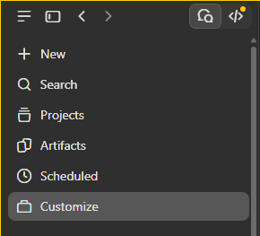
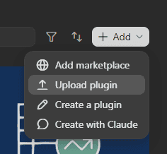
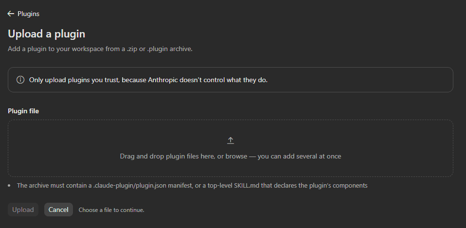
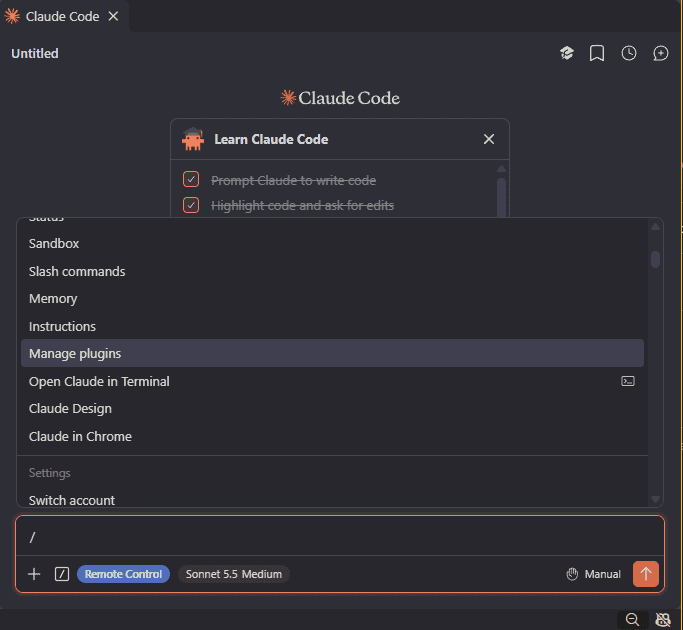
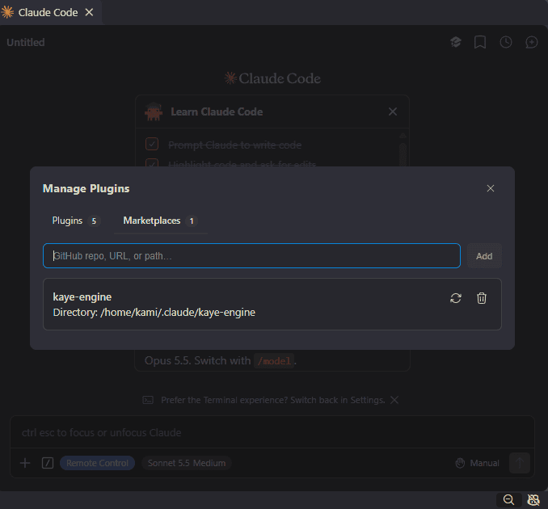

# Kaye Engine: Support for Anthropic Claude

Export your corpus to Claude as plugins, Agent Skills, or a system prompt with `kaye-engine claude` (alias `a`). Every non-internal exportable is rendered.

## Use in Claude Desktop

1. Create the plugin zip:

   ```bash
   kaye-engine claude plugin -z
   ```

   One zip per consumer lands in the current directory, named `CONSUMER-claude-VERSION.zip`, e.g. `my-corpus-claude-1.2.1.zip`.

2. Upload the zip in the Claude Desktop app:

   1. Click *Customize* in the sidebar.

      

   2. Open the *Plugins* tab.

      

   3. Click *Add* → *Upload plugin*.

      

   4. Drop the zip into the dialog, or browse for it, then click *Upload*.

      

To update, export again and upload the new zip.

## Use in the Claude Code VS Code Extension

1. Run the setup command:

   ```bash
   kaye-engine claude vs-code-extension
   ```

   It does 3 things in `~/.claude/`: writes your `CLAUDE.md` system prompt, builds a marketplace folder `kaye-engine/` holding your plugins, and adds Bash permissions to `settings.json`. It prints the marketplace location; keep it for step 3:

   ```text
   INFO  kaye-engine.claude: marketplace.json location:
   /home/USER/.claude/kaye-engine/.claude-plugin/marketplace.json
   ```

2. Open the plugin manager: in the *Claude Code* panel, type `/` and choose *Manage plugins*.

   

3. Add the marketplace: in the *Marketplaces* tab, paste the `marketplace.json` path printed in step 1 (`/home/USER/.claude/kaye-engine/.claude-plugin/marketplace.json`) and click *Add*. The `kaye-engine` marketplace now appears in the list.

   

4. Install your plugins: switch to the *Plugins* tab and install each consumer project's plugin. The marketplace only lists them; nothing is active until you install it.

To update, run the command again.

> [!WARNING]
> `settings.json` is edited in place. Check the result if you keep your own Bash permission rules there.

## Choose a Subcommand

| Goal | Command | Alias |
| --- | --- | --- |
| Upload a plugin to Claude Desktop | `claude plugin -z` | `claude p` |
| Get a plugin folder to load locally | `claude plugin` | `claude p` |
| Export every skill into `~/.claude/skills` | `claude skills` | `claude s` |
| Get an installable marketplace folder | `claude marketplace` | `claude m` |
| Set up Claude Code in the terminal | `claude code` | `claude c` |
| Set up the Claude Code VS Code Extension | `claude vs-code-extension` | `claude v` |
| Print the User System Prompt | `claude user-system-prompt` | `claude usp` |

> [!NOTE]
> To export chosen skills into a folder you name, use the top-level `kaye-engine skill NAME... FOLDER` (or `--all`) instead of `claude skills`.

### plugin

Writes one plugin per consumer, with one skill per exportable.

```bash
kaye-engine claude plugin              # ~/.claude/plugins/PLUGIN_NAME/
kaye-engine claude plugin FOLDER       # FOLDER/PLUGIN_NAME/
kaye-engine claude plugin -z           # one .zip per consumer
kaye-engine claude plugin -z . NAME    # only consumer NAME's zip
```

- `-z`, `--zip`: write upload-ready zips instead of folders
- `--no-version`: drop the version from the zip name, giving `NAME-claude.zip`

### skills

Writes every exportable as its own skill folder.

```bash
kaye-engine claude skills              # ~/.claude/skills/
kaye-engine claude skills FOLDER
kaye-engine claude skills -z           # one .zip per skill
```

### marketplace

Wraps every consumer's plugin in one marketplace named `kaye-engine`. Add the resulting folder in Claude's marketplace settings.

```bash
kaye-engine claude marketplace         # ~/.claude/kaye-engine/
kaye-engine claude marketplace FOLDER
```

### code

Sets up Claude Code: writes `CLAUDE.md` (the User System Prompt) and every consumer's plugin.

```bash
kaye-engine claude code                # into ~/.claude
kaye-engine claude code CLAUDE_FOLDER
```

### vs-code-extension

Does what `code` does for the VS Code extension, but wraps plugins in a marketplace and updates `settings.json`; steps in [Use in the Claude Code VS Code Extension](#use-in-the-claude-code-vs-code-extension).

```bash
kaye-engine claude vs-code-extension
kaye-engine claude vs-code-extension CLAUDE_FOLDER
```

### user-system-prompt

Prints the Chat prompt to stdout; nothing is written unless you redirect it.

```bash
kaye-engine claude usp > ~/.claude/CLAUDE.md
kaye-engine claude usp -c > ~/.claude/CLAUDE.md   # also append the Coder prompt
```

Here `-c` means `--coder`; the comment toggle is long-form only (`--comment`/`--no-comment`).

## Render Flags

Every subcommand except `user-system-prompt` takes the same render flags, explained in [render-profile-doc.md](render-profile-doc.md):

- `-s`, `--sparseness`: blank-line policy
- `--comment`/`--no-comment`: show or omit comment nodes
- `--variant`, `-i`/`--conditional-sidecar`: extra variants and sidecars to include
- `--reverse-order`: reverse sibling order
- `-u`, `--surface`: render profile to target, see [Surfaces](#surfaces)
- `-n`, `--dry-run`: report every write, write nothing
- `-v`, `-q`, `-V`, `-Q`: verbosity

## Surfaces

A **surface** is a target Kaye Engine renders for, since different apps offer different tools. Claude has 2: `claude` for the chat apps and Claude Code in the terminal, and `claude-vsc` for the VS Code extension. Each subcommand picks its own surface unless you pass `--surface`; see [render-profile-doc.md](render-profile-doc.md#surfaces).

## Setup for Consumer Packages

Every command needs the consumer package to register itself first; without it, the command logs a critical error and exits 1.

- Consumer: call `register_consumer(display_name, canonical_name, version)` once. The canonical name is the plugin name and must equal the installed distribution name
- Console command: call `set_entry_consumer(canonical_name)` and `setup_claude_cli(...)` during setup
- Chat and Coder: `code`, `vs-code-extension`, and `user-system-prompt` also need the Chat and merged Coder exportable names passed to `setup_claude_cli(...)`; the merged Coder should list Chat as a dependency

## Editing the Corpus

1. Edit a corpus Markdown file in the consumer package.
2. Run `kaye-engine blueprint validate`.
3. Export again with the `claude` subcommand you use.
