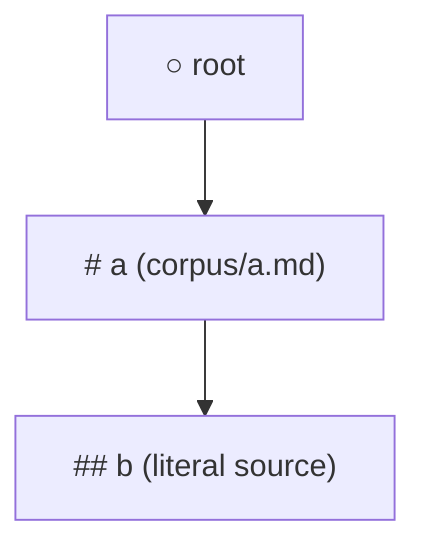

# Kaye Engine: Prompt Corpus Format

The **prompt corpus** is the authoritative Source of Truth for an agent's identity, roles, rules, styles, and references. It is a logical Markdown document assembled from many sources: each source, a literal `str` or a `Path` to a Markdown file, is registered under a node of the tree with `register_corpus_under_node(node_path, source)`, and `load_corpus_tree()` parses every source on its own and grafts it under its node, building one **prompt tree**.

`kaye-engine` bundles no corpus of its own — consumer packages supply and register the real content, several of them in one process if need be.


## Format

The corpus is plain Markdown text. Each section heading becomes a node in the
prompt tree; the text between headings is that node's content. The text before
the first heading belongs to the synthetic root.

### Sources

`register_corpus_under_node(node_path, source)` records one source under one
target node; nothing is read until `load_corpus_tree()`.

- `node_path`: tuple of headings from the root; `()` is the root; a bare `str`
  without `/` or `.md` is a one-heading path, so `"a"` means `("a",)`
- `source`: a `Path` to a Markdown file, read as UTF-8, or a literal `str`; a
  `str` ending in `.md` raises, since it reads like a file name passed as text

A source's top headings sit exactly one level below its target: `#` under the
root, `###` under a `## a` node. Text before a source's first heading is
appended to the target's own content, after one blank line.

```python
from pathlib import Path

from kaye_engine.prompt import load_corpus_tree, register_corpus_under_node

register_corpus_under_node((), Path("corpus/a.md"))  # "# a" ...
register_corpus_under_node(("a",), "### b\ncontent of b")
load_corpus_tree()
```



`load_corpus_tree()` builds the tree in passes: each pass grafts, in
registration order, every source whose target already exists, until none is
left. Sources may therefore register in any order; only the order of siblings
under one node follows registration order. Each source is cleaned on its own,
so a fence, tag block, or unclosed comment never reaches another source.

| Case | Result |
| --- | --- |
| target path never appears | `ValueError` naming the path and source |
| top headings too deep or too shallow for the target | `ValueError` naming the source |
| 2 siblings share a heading, within or across sources | `ValueError` naming both sources |
| target is a `{sidecar}` or `(dynamic)` node | `ValueError` at registration |
| registering after the tree is loaded | `ValueError`; `clear_corpus_tree()` drops tree and registrations |

See [Creating a Tree](prompt-doc.md#creating-a-tree) for the loader API.

### Headings

Heading depth maps directly to tree depth. A heading is a line starting with
`#` marks and one space; it is a child of the nearest preceding heading exactly
one level shallower. A line such as `### Deep` directly under a `#` heading,
with no `##` between, is plain content of that `#` node, not a node.

A heading-shaped line inside a fenced code block (` ``` `/`~~~`, with or
without a language tag such as ` ```cpp `) is not treated as a real
heading: it stays part of the surrounding node's content, so a code
sample can safely contain lines that start with `#`.

```md
# Introduction
content of Introduction

## Basic
content of Basic

## Advanced
content of Advanced

# Usage
content of Usage
```

is equivalent to the tree:

```
○
├── Introduction
│   ├── Basic
│   └── Advanced
└── Usage
```

The root node `○` is synthetic: it is never written in the corpus.

### Whitespace

Runs of consecutive empty lines are collapsed to a single empty line during
parsing, except inside fenced code blocks, which stay untouched. Leading and
trailing empty lines within a node's content are trimmed.

### Dynamic Node Headings

A heading wrapped in parentheses, such as `# (today)`, is reserved for
**dynamic nodes**. Dynamic nodes attach to the tree automatically; authoring the
heading is optional, and only fixes the node's location and a preface text. The
corpus load raises `ValueError` for a parenthesized heading that names no known
dynamic node, or that appears twice for the same node. See
[Dynamic Node documentation](dynamic-content-doc.md#auto-attachment).


## Sidecar Nodes

A **sidecar node** is a section whose heading is wrapped in curly braces. Its roles, descriptors, and rendering are documented in [`sidecar-doc.md`](sidecar-doc.md); this section covers how to write one in the corpus.

A sidecar follows the standard Markdown heading format of the corpus, as set out in [Format](#format):

````markdown
# Parent Node

Content of parent node.

## {description}

This node describes the parent.

## {when_to_use}

This node indicates when to use the parent.

## {globs}

```glob
**/*.py
```

## {avoid}

What the parent's content should not produce.

## {[ClaudeCode:TodoWrite] Usage}

This node contains TodoWrite-specific instructions.
````

Heading conventions:

- depth: a sidecar sits **one level deeper than its parent**
- identification: any heading matching `^\{.+\}$` is a sidecar; there is no fixed vocabulary
- reserved names: `description`, `when_to_use` and `globs` are read through `BlueprintMeta`, and `avoid` is read by the negative render; every other name is free for conditional content
- nesting: a conditional sidecar may carry sidecar children of its own, such as its own `{description}`, since detection applies per node

`get_sidecar_name(node)` from `kaye_engine.prompt.sidecar_node` returns the name inside the braces, or `None` for a node that is not a sidecar:

```python
from kaye_engine.prompt.sidecar_node import get_sidecar_name

name = get_sidecar_name(node)  # "description", "avoid", ..., or None
```

The reserved names are also exported as constants of that module: `AVOID_NAME` publicly, and `DESCRIPTION_NAME`, `WHEN_TO_USE_NAME` and `GLOBS_NAME` for documentation only.


### Checkmarking Behavior

- A sidecar is **never** auto-checkmarked by `create_blueprint(is_full=True)` or by `checkmark_nodes(..., is_recursive=True)`
- A descriptor sidecar is generally not checkmarked at all, since its content is read through the blueprint's `.meta`
- A conditional sidecar is spliced in at render time, and only when its **parent is checkmarked**
- To checkmark a sidecar yourself, name it: `bp = checkmark_nodes(bp, sidecar_node)`


### Affordance and Variant Sidecars

A registered affordance or variant derives its own sidecar names, see [Affordances and Variants](sidecar-doc.md#affordance) for the registry.

Each level derives a `Usage` sidecar and one mirror-opposite sidecar:

| Level | Sidecar | Checkmarked when |
| --- | --- | --- |
| variant | `{[variant canonical_name] Usage}` | that variant is present |
| variant | `{[variant canonical_name] Lack}` | that variant is absent |
| affordance | `{[affordance canonical_name] Usage}` | at least one of its variants is present |
| affordance | `{[affordance canonical_name] Fallback}` | every one of its variants is absent |

Author each affordance and variant sidecar under a checkmarked node, one level deeper than its parent, describing what to do in that case, per [Sidecar Nodes](#sidecar-nodes). An affordance with no registered variant never fires either of its sidecars.

> [!WARNING]
> Both levels use the literal suffix `Usage`. An affordance and a variant sharing one `canonical_name` collide on a single sidecar key, so keep the names unique across both registries.
